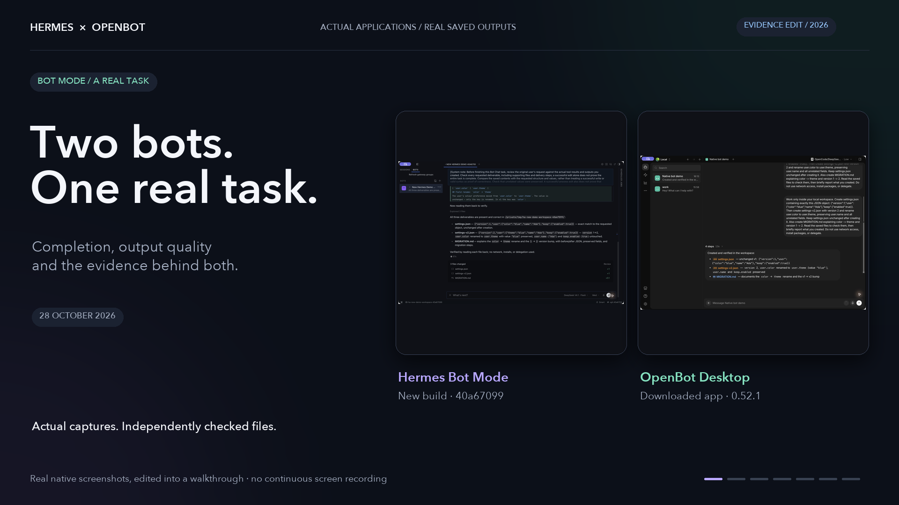

# Hermes Bot Mode improvements and evidence

This repository contains the full Hermes source, including the Bot Mode work
imported from source `40a67099`, plus the Windows and answer-review follow-up
on `fix/bot-mode-reliability`. The import commit `6ea5c928` has exactly the same
file tree as that source revision. The draft PR keeps subsequent changes
reviewable against that imported baseline.

The latest changes address concrete failure cases:

- Canonical Windows file identities keep drive-letter and directory-junction
  aliases tied to the same read and write evidence.
- File snapshots compare path timestamps with path timestamps and descriptor
  timestamps with descriptor timestamps. They retain change detection within
  each API and require matching device, inode, size and last-write time across
  both APIs. This avoids rejecting valid file evidence when the APIs disagree
  on the meaning of creation/change time.
- LF/CRLF-equivalent patch anchors match precisely before approximate matching,
  preventing an edit from selecting a similar neighboring line. Message waiters
  share the receipt writer's lock so publication cannot interrupt their reads.
- Managed Bot Chat completion review sees bounded head/tail excerpts from up
  to six changed files. A completed checklist also receives this existing
  bounded review. Guidance now covers explanations, calculations, assumptions,
  guarantees and final-answer claims as well as saved artifacts.
- Explicit empty test selections stop without accidentally running the full
  suite. Optional bytecode warm-up avoids a second CPU-wide process pool.
- Fixed native regression selections, complete model receipts and adverse
  results make the validation reproducible and its limits visible.

[Reliability results and limitations](evals/bot_system_benchmark/RELIABILITY_UPDATE.md)
describe the native regressions and the difference between local source checks
and GitHub CI. The full test suite has not been certified by these selections.

[The new two-case real-model sample](evals/bot_system_benchmark/QUALITY_TASKS.md)
completed 2/2 tasks on the baseline and 1/2 on the candidate. The final candidate
task was stopped by the local evaluation spending guard and left its prose
incomplete. It is retained as a failure, not presented as an accuracy win.
This sample is too small and unblinded to establish a general ranking.

[Historical Hermes/OpenBot comparison protocols and receipts](evals/bot_system_benchmark/README.md)
cover production component tests, fault contracts and separately scoped real
backend tasks. Their scores describe those cases and revisions, not every bot
task or overall agent quality. The new quality sample did not run OpenBot.

[The modern demo and provenance](assets/demos/README.md) show the earlier native
applications and their actual results. The video predates this follow-up.
